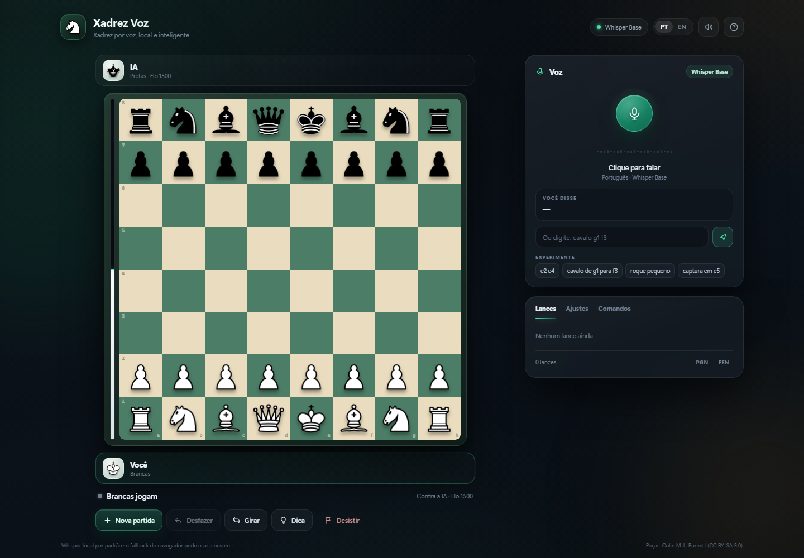

# ♞ Xadrez Voz

Xadrez completo no navegador, controlado por **voz em português e inglês**, com
**Whisper local quantizado** (whisper.cpp), IA de xadrez integrada e modo para
dois jogadores.



> **Demo com Whisper no servidor:** https://xadrez-voz-three.vercel.app/
>
> **Demo estática:** https://bryanrafaelbueno.github.io/xadrez-voz/
>
> No GitHub Pages, xadrez e IA rodam no navegador; a voz usa o reconhecimento
> do navegador. Na Vercel, a voz é transcrita pelo Whisper base na função
> serverless. Whisper residente e narração neural exigem rodar o `start.bat` no
> computador.

[](https://vercel.com/new/clone?repository-url=https://github.com/bryanrafaelbueno/xadrez-voz)

## Versão online (GitHub Pages)

**https://bryanrafaelbueno.github.io/xadrez-voz/**

A versão estática funciona sem instalar nada:

- Regras completas, tabuleiro, IA com Elo de 400 a 2400, dicas, PGN e FEN.
- Comandos por texto e por voz usando o **reconhecimento do navegador**
  (Chrome/Edge; esse caminho usa a nuvem do navegador).
- Narração pela voz **pt-BR disponível no navegador**, se houver.
- O modelo Whisper local, o servidor Python e a narração neural pt-BR **não
  rodam no GitHub Pages** (Pages é somente estático). Para a experiência
  completa, rode o projeto localmente com `start.bat`.

O repositório não versiona as pastas `bin/`, `models/` e `vendor/` por causa do
tamanho dos binários (Whisper, eSpeak e runtime da voz). A demo online não
precisa delas; a cópia local do projeto já as contém.

## Deploy na Vercel (Whisper no servidor)

**https://xadrez-voz-three.vercel.app/**

A versão Vercel roda **Whisper base no servidor** (função Python serverless)
e mantém o tabuleiro, a IA e o restante do app no navegador. A narração pt-BR
usa a voz do navegador nesta versão.

- **Projeto:** `xadrez-voz`, conectado ao repositório na branch `main`.
- **Botão:** use o botão *Deploy with Vercel* no topo deste README.
- **Modelo:** `ggml-base-q5_1` (57 MB) é baixado durante o build e embutido na
  função; não fica no Git.
- **API:** `/api/health`, `/api/transcribe` e `/api/tts` (esta retorna 503,
  porque a narração é do navegador).
- **Cold start:** a primeira fala após uma nova instância carrega o modelo e
  pode demorar alguns segundos; a Vercel permite até 300s por requisição.
- **Pywhispercpp / Python 3.12:** as dependências e a versão do runtime estão
  em `requirements.txt` e `vercel.json`.
- **CLI opcional:**

```powershell
npx vercel login
npx vercel --prod
```

> Observação: no Windows, o build local do CLI pode falhar ao criar symlinks
> do builder. Nesse caso, use o botão/importação do GitHub, que faz o build
> diretamente na Vercel.

A versão local (`start.bat`) continua sendo a única com **Whisper local
residente + narração neural TinyVoca**. O GitHub Pages continua sendo a demo
estática sem backend.

## Destaques

- **Regras completas**: roques, en passant, promoção, xeque, xeque-mate,
  afogamento, regra dos 50 lances, repetição tripla e material insuficiente.
- **Voz local**: microfone → WAV 16 kHz → Whisper quantizado no seu computador.
  Nenhum áudio é enviado para servidores quando o Whisper local está ativo.
- **Narração em pt-BR**: voz neural local (tiny-voca) com opções feminina e
  masculina, além do teste “Ouvir voz” nos Ajustes.
- **Português e inglês**: interface, narração e reconhecimento nos dois idiomas.
- **IA de xadrez**: motor próprio em Web Worker (alpha-beta/PVS, tabela de
  transposição, quiescência, LMR) com **Elo aproximado de 400 a 2400**, dicas e
  barra de avaliação.
- **Modo 2 jogadores** e **modo contra a IA**, jogando com brancas ou pretas.
- **Comandos naturais**: “e2 e4”, “e dois e quatro”, “cavalo de g1 para f3”,
  “peão toma d5”, “captura em e5”, “roque pequeno”, “promover a dama”.
- **Escuta contínua** opcional, narração por voz, histórico, PGN e FEN.
- Funciona **offline** depois de iniciado (o fallback do navegador, se usado,
  pode acessar a nuvem).

## Início rápido (Windows)

1. Confira que a pasta `models/` tem os modelos e que `bin/whisper/` tem o
   whisper.cpp (ambos já acompanham este projeto).
2. Dê **duplo clique em `start.bat`**.
3. O navegador abre em `http://127.0.0.1:8765/` (ou na próxima porta livre).
4. Clique no microfone e permita o acesso quando o navegador pedir.

Requisitos: Windows x64, Python **3.14 x64** (o runtime da voz incluído em
`vendor/tts/` é para essa versão; com outra versão o reconhecimento continua
funcionando, mas a voz pt-BR local pode ficar indisponível), microfone e um
navegador Chromium/Edge/Chrome atualizado. Não é preciso instalar pacotes com
`pip`. Node.js é usado apenas para os testes, não para executar o app.

Se preferir iniciar manualmente:

```powershell
cd D:\Projetos\xadrez-voz
python server.py
```

Opções do servidor:

```powershell
python server.py --port 8765 --model base --threads 6
python server.py --cli        # sem servidor Whisper residente
python server.py --no-tts     # sem a voz local de narração
python server.py --no-browser
```

## Como jogar

- **Clique** em uma peça e depois na casa de destino, ou use a voz.
- **Microfone**: uma sessão escuta um comando e para. Ative **Escuta contínua**
  em Ajustes para o microfone voltar a ouvir depois de cada lance.
- **Atalho**: tecla `V` inicia/para a escuta (quando não está digitando).
- **Modo 2 jogadores**: os dois lados são controlados por clique/voz.
- **Dica**: o motor sugere um lance para o jogador da vez.
- **Elo da IA**: em Ajustes → **Elo da IA**, escolha de 400 a 2400 em passos de
  100. O valor altera a profundidade, o tempo de busca e a chance de erros da
  IA; a dica continua sempre forte. O Elo é uma **estimativa aproximada**.
- **Desfazer**: no modo IA, volta o lance seu e o da IA.
- **Narração**: em Ajustes, escolha entre voz **feminina** e **masculina** e use
  **Testar voz** para ouvir uma amostra. Também há amostras em
  `docs/voz-feminina.wav` e `docs/voz-masculina.wav`.
- **PGN/FEN**: botões na aba Lances copiam a partida/posição.

## Comandos de voz

| Português | English | Ação |
|---|---|---|
| `e2 e4` / `e dois e quatro` | `e2 e4` / `e two e four` | Lance por coordenadas |
| `cavalo de g1 para f3` | `knight from g1 to f3` | Peça + origem/destino |
| `cavalo f3` | `knight f3` | Peça + destino (se único) |
| `peão toma d5` | `pawn takes d5` | Captura |
| `captura em e5` | `capture on e5` | Captura no destino |
| `roque pequeno` / `roque grande` | `castle kingside` / `castle queenside` | Roques |
| `peão a7 a8 promover a dama` | `pawn a7 a8 promote to queen` | Promoção |
| `desfazer` | `undo` | Volta o lance |
| `nova partida` | `new game` | Reinicia |
| `dica` | `hint` | Sugere um lance |
| `girar tabuleiro` | `flip board` | Inverte o tabuleiro |
| `situação` | `status` | Fala o estado da partida |

O reconhecimento entende nomes de letras (“bê”, “efe”, “agá”), números por
extenso, alfabeto NATO (`echo two`), comandos parciais e pequenas falhas do
transcritor (por exemplo, “torre de a1 para oito” vira a1–a8).

## IA e Elo aproximado

O seletor **Ajustes → Elo da IA** vai de **400 a 2400**, em passos de 100. Cada
faixa ajusta três coisas no motor:

| Elo aprox. | Faixa | Profundidade | Tempo | Chance de lance aleatório |
|---|---|---:|---:|---:|
| 400–700 | Iniciante | 1–3 | 0,1–0,2 s | 45–22% |
| 800–1100 | Casual | 3–5 | 0,25–0,48 s | 17–7,5% |
| 1200–1500 | Clube | 5–7 | 0,6–1,1 s | 5,5–1,8% |
| 1600–1900 | Forte | 8–9 | 1,3–2,2 s | 1,2–0,3% |
| 2000–2400 | Mestre | 10–13 | 2,6–4,6 s | 0–0,2% |

O valor é uma **estimativa**: não é uma lista de rating oficial. A força real
depende da posição, do tempo de reflexão e do computador. O rodapé da partida
mostra “Contra a IA · Elo 1500”. No modo 2 jogadores o seletor fica oculto.

## Whisper local e modelos

O app usa `whisper.cpp` com modelos **q5_1** quantizados:

| Modelo | Tamanho | Tempo típico* | Uso |
|---|---:|---:|---|
| Base | 57 MB | ~2 s | padrão, rápido |
| Small | 181 MB | ~7 s | mais preciso com sotaques/ruído |

\* Intel i7-6700, comandos de 2–3 s, com o modelo já carregado. O primeiro uso
após iniciar pode levar alguns segundos a mais.

Você pode alternar em **Ajustes → Modelo Whisper**. Para baixar/restaurar os
modelos:

```powershell
powershell -ExecutionPolicy Bypass -File scripts/download-models.ps1
```

O script baixa `ggml-base-q5_1.bin`, `ggml-small-q5_1.bin` e a voz pt-BR em
`models/tiny-voca/`. Também é possível usar qualquer `ggml-*.bin` colocado em
`models/`; ele aparecerá na lista.

### Fallback do navegador

Se o servidor Whisper não estiver ativo, o app tenta usar a API de reconhecimento
de voz do navegador (Chrome/Edge). Esse caminho **pode enviar áudio para a
nuvem** — por isso ele é indicado no selo da voz e no rodapé. Para uso 100%
local, mantenha o servidor Whisper rodando.

## Voz pt-BR da narração

A narração dos lances usa uma voz neural brasileira executada **localmente**
(tiny-voca pt-BR, 21 MB, 24 kHz), com vozes feminina e masculina. Ela não
depende das vozes instaladas no Windows — que, neste computador, eram apenas
em inglês.

- Modelo: `models/tiny-voca/`
- Runtime: `vendor/tts/` (numpy + onnxruntime) e `vendor/tinyvoca/`
- Fonemas: `bin/espeak-ng/` (eSpeak NG)
- Endpoint: `POST /api/tts` (texto → WAV)
- Tempo típico: **0,1–0,3 s** para gerar uma frase curta, depois que o modelo
  foi carregado; o áudio toca em seguida.

Em **Ajustes → Narração em voz alta**, escolha a voz e clique em **Testar voz**.
A narração em inglês continua usando a voz do navegador. Se a voz local não
estiver disponível, o app tenta a voz pt-BR do navegador (se existir) e mostra
isso no Ajustes; ele não lê português com uma voz inglesa.

Amostras prontas: `docs/voz-feminina.wav`, `docs/voz-masculina.wav` e a página
`docs/vozes.html` para ouvir as duas.

## Arquitetura

```
index.html            Interface
css/styles.css        Tema e layout responsivo
js/chess.js           Regras completas (0x88), FEN, SAN, PGN auxiliar
js/ai.js              Motor de xadrez (alpha-beta/PVS + avaliação)
js/ai-worker.js       Executa a IA em Web Worker
js/parser.js          Interpretador de comandos PT/EN
js/voice.js           Microfone, VAD, WAV 16 kHz, Whisper e fallback
js/pcm-worklet.js     Captura PCM via AudioWorklet
js/speech.js          Narração local pt-BR + Web Speech API
js/sound.js           Efeitos sonoros sintetizados
js/main.js            Controle do app
js/i18n.js            Textos PT/EN e descrição de lances
server.py             HTTP local, Whisper e voz pt-BR
api/                  Funções serverless da Vercel (Whisper base)
vercel.json           Build/output das funções e do site na Vercel
requirements.txt      Dependências Python da função Vercel
bin/whisper/          whisper.cpp (whisper-server, whisper-cli e DLLs)
bin/espeak-ng/        eSpeak NG (fonemas da narração)
models/               Whisper GGML + voz tiny-voca
vendor/tinyvoca/      Modelo/front-end da voz pt-BR (Apache-2.0)
vendor/tts/           numpy + onnxruntime para a voz local
tests/                Perft, parser, IA, voz e utilidades
```

O servidor mantém o `whisper-server` residente para evitar recarregar o modelo
a cada comando e cai automaticamente para o `whisper-cli` se necessário. A voz
pt-BR é carregada no próprio processo do servidor e usa apenas a máquina local.
Não é necessário rodar `pip install` no Python 3.14 x64.

## Testes

```powershell
node tests/perft.test.mjs
node tests/parser.test.mjs
node tests/ai.test.mjs
node tests/keys.test.mjs
python tests/tts_local.py
```

- **Perft**: cinco posições de referência, incluindo Kiwipete.
- **Parser**: comandos PT/EN, transcrições ruidosas, ambiguidade e promoção.
- **IA**: mate em 1, legalidade, auto-jogo e a escala de Elo 400–2400.
- **Chaves i18n**: confere se todas as chaves usadas existem.
- **Voz**: sintetiza frases nas duas vozes pt-BR e valida o áudio.

## Solução de problemas

**“Whisper local indisponível”** — confira `bin/whisper/whisper-server.exe` e os
modelos em `models/`. Veja também `whisper-server.log` na raiz do projeto.

**A porta 8765 está ocupada** — o servidor escolhe automaticamente a próxima
porta livre e mostra a URL no console.

**Microfone negado** — libere o microfone nas permissões do navegador
(ícone ao lado da barra de endereço) e recarregue a página.

**Sem voz pt-BR** — em Ajustes, confira o texto abaixo de “Narração em voz alta”.
Se disser “voz pt-BR local”, clique em **Testar voz**. Se disser que está
indisponível, confira `models/tiny-voca/`, `vendor/tts/` e `bin/espeak-ng/` e veja
o console do servidor. A narração em inglês usa a voz do navegador.

**A voz sai em inglês** — confirme que o idioma do app está em **PT** e que a
voz local apareceu em Ajustes. O narrador não usa voz inglesa para ler
português: se a voz local e a voz pt-BR do navegador faltarem, ele fica em
silêncio e o Ajustes mostra o aviso.

**A transcrição demora** — use o modelo Base em Ajustes. Ele é o padrão e leva
cerca de 2 s neste computador.

**Comando não reconhecido** — fale as coordenadas juntas (“e2 e4”) ou diga a
peça e a casa de destino (“cavalo f3”). Também é possível digitar o comando no
campo de texto.

**Primeiro uso do Windows** — se o SmartScreen/antivírus bloquear o
`whisper-server.exe`, permita o executável local.

**Python não encontrado** — instale o Python 3 em python.org e marque “Add
Python to PATH”, ou use `py -3 server.py`.

## Privacidade

- Com o Whisper local ativo, o áudio é processado na sua máquina e não sai dela.
- No deploy da Vercel, o áudio é enviado por HTTPS para a função serverless da
  Vercel e processado lá; o WAV temporário é apagado após a transcrição.
- A narração pt-BR também é sintetizada localmente na versão desktop; apenas o
  texto do lance é enviado ao servidor local em `127.0.0.1`, nunca à internet.
- O áudio temporário é apagado do disco logo após a transcrição.
- O servidor local escuta apenas em `127.0.0.1`.
- O fallback do navegador pode usar serviços de nuvem do navegador; ele só é
  usado quando o Whisper do servidor falha e é identificado na interface.

## Créditos e licenças

- Peças de xadrez: **Colin M. L. Burnett**, licença CC BY-SA 3.0
  (via repositório do Lichess).
- [whisper.cpp](https://github.com/ggml-org/whisper.cpp): MIT.
- [pywhispercpp](https://github.com/absadiki/pywhispercpp): MIT (bindings usados na função Vercel).
- Modelos [OpenAI Whisper](https://github.com/openai/whisper): MIT.
- Voz [tiny-voca pt-BR](https://huggingface.co/Haple/tiny-voca-ptbr-kokoro):
  Apache-2.0.
- [eSpeak NG](https://github.com/espeak-ng/espeak-ng): GPL-3.0-or-later.
- Motor de xadrez, interface e servidor deste projeto: feitos para este app.

Veja `CREDITS.md` e `THIRD_PARTY_NOTICES.md` para os textos completos.
